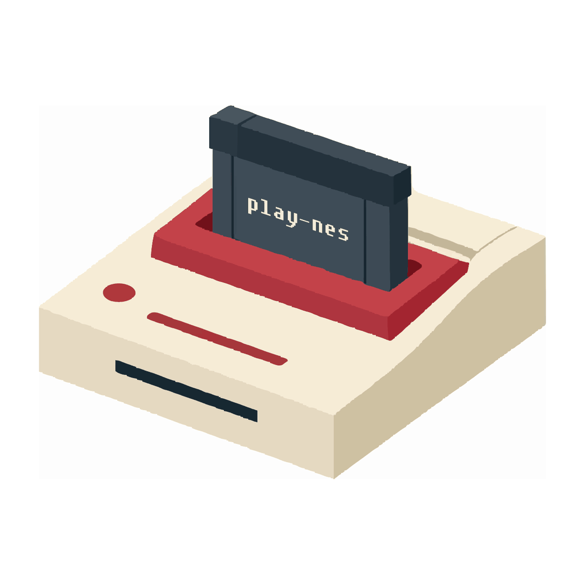

<p align="center">
  <a href="./assets/play-nes-console-logo.svg">
    
  </a>
</p>

<h1 align="center">play-nes</h1>

<p align="center">
  <strong>NES games, in a native desktop window.</strong><br>
  A TypeScript player powered by <a href="https://github.com/bfirsh/jsnes">JSNES</a> and <a href="https://sfml.js.org/">sfml.js</a>.
</p>

<p align="center">
  <a href="https://www.npmjs.com/package/play-nes">npm</a> ·
  <a href="#quick-start">Quick start</a> ·
  <a href="#games">Games</a> ·
  <a href="#controls">Controls</a> ·
  <a href="#development">Development</a>
</p>

---

**Two players** · **256 × 240 video** · **48 kHz stereo audio** · **Your own ROMs**

## Quick start

Install [play-nes from npm](https://www.npmjs.com/package/play-nes) to get the `nes` command:

```bash
npm install -g play-nes
nes contra
```

> **Release status:** npm currently publishes `play-nes@1.0.2`, which uses the previous SFML binding. This branch contains the unpublished TypeScript migration with **JSNES 2.1.0** and **sfml.js 1.0.0-rc.2**. To try this version, run it from a checkout below.

<details>
<summary><strong>Run the current checkout</strong></summary>

Inside the `play-nes` project directory:

```bash
npm install
node bin/nes contra
```

Here, `npm install` installs the project's dependencies and compiles TypeScript. Use `node bin/nes` wherever the examples below use `nes`, or run `npm link` to make this checkout available as the global command.

</details>

<details>
<summary><strong>Build requirements for the rc2 version</strong></summary>

Use **Node.js 22**; the supported range is `^18.19.0 || >=20.5.0`. sfml.js downloads SFML libraries and compiles a native addon during installation, so Python and a C++20 toolchain are required.

| Platform | Toolchain |
| :--- | :--- |
| macOS 13+ · Intel / Apple Silicon | Xcode Command Line Tools |
| Linux · x64 | GCC or Clang, make, X11, OpenGL and audio development libraries |
| Windows · x64 / ia32 | Visual Studio 2022 C++ Build Tools |

See the [sfml.js installation guide](https://sfml.js.org/guide/getting-started) for setup commands. Run in a desktop session with an audio output device. This version has been verified on macOS with Node.js 22; Linux and Windows remain unverified.

</details>

## Games

Four ROMs are included. Pick an alias and start playing:

| Game | Command |
| :--- | :--- |
| Contra | `nes contra` |
| croom | `nes croom` |
| dgolf | `nes dgolf` |
| Interglactic Transmissing | `nes transmissing` |

Or load a ROM from disk:

```bash
nes "/path/to/your game.nes"
```

## Controls

| NES button | Player 1 | Player 2 |
| :--- | :---: | :---: |
| A | <kbd>J</kbd> | <kbd>Numpad 5</kbd> |
| B | <kbd>K</kbd> | <kbd>Numpad 6</kbd> |
| Select | <kbd>Right Shift</kbd> | <kbd>Numpad 8</kbd> |
| Start | <kbd>Enter</kbd> | <kbd>Numpad 9</kbd> |
| Up | <kbd>W</kbd> | <kbd>↑</kbd> |
| Down | <kbd>S</kbd> | <kbd>↓</kbd> |
| Left | <kbd>A</kbd> | <kbd>←</kbd> |
| Right | <kbd>D</kbd> | <kbd>→</kbd> |

<kbd>Esc</kbd> quits. Closing the window also stops the audio Worker. Held buttons are released when the window loses focus.

Customize [keybindings.conf](./keybindings.conf) with [sfml.js key names](https://sfml.js.org/reference/enums/KeyboardKey.html), then restart the player.

## Options

```bash
nes contra --scale 3
nes croom -f 60 -s 2
nes --help
```

| Option | Default | Description |
| :--- | :---: | :--- |
| `-s`, `--scale` | `2` | Scale the 256 × 240 frame; the default window is 512 × 480. |
| `-f`, `--frameRate` | `60` | Emulation and display rate, from 10 to 240 fps in this branch. |
| `-h`, `--help` | — | Show usage and exit. |

Changing the frame rate changes game speed too. Scale must be positive and produce whole-pixel window dimensions.

## Development

The source lives in [`src/`](./src). `tsc` compiles it to ESM in `dist/`; the player runs directly in Node.js.

```bash
npm run build        # Compile TypeScript after editing
npm run check        # Strict type checking
npm run lint         # Check code style
npm test             # Build and run tests without opening a window
npm run test:native  # Exercise all four ROMs with native video and audio
```

<details>
<summary><strong>How the player works</strong></summary>

| Part | Responsibility |
| :--- | :--- |
| [`cli.ts`](./src/cli.ts) | Parse arguments and resolve ROM aliases before loading native graphics. |
| [`game.ts`](./src/game.ts) | Own the window and reuse the image, texture, sprite and FPS text. |
| [`controller.ts`](./src/controller.ts) | Translate keyboard events into two shared button masks. |
| [`audio-worker.ts`](./src/audio-worker.ts) · [`emulator.ts`](./src/emulator.ts) | Run JSNES in the SFML audio Worker and fill reusable native PCM buffers. |
| [`shared-state.ts`](./src/shared-state.ts) | Share the latest complete frame and input state across threads. |

Audio demand drives emulation. Samples left at a block boundary carry over to the next callback, including silence. The main thread displays complete frames and yields to Node.js between draws; shutdown waits for the audio Worker to close.

</details>

## Contributing

[Issues](https://github.com/XadillaX/play-nes/issues) and pull requests are welcome. For bug reports, include the ROM name, Node.js version, operating system and steps to reproduce.

[MIT licensed](./LICENSE).
