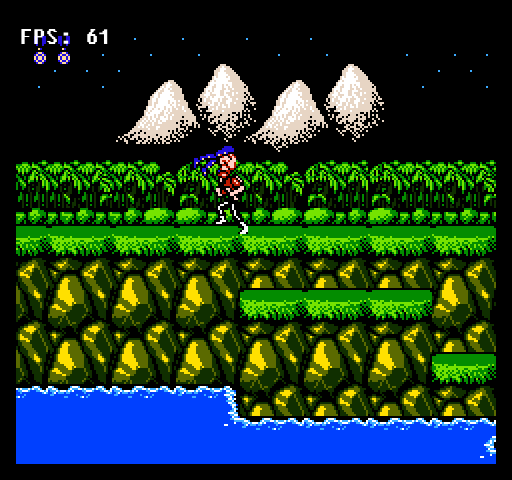
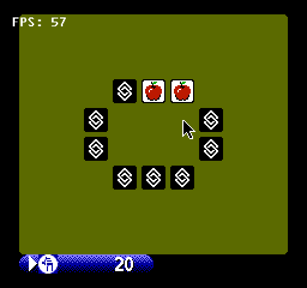
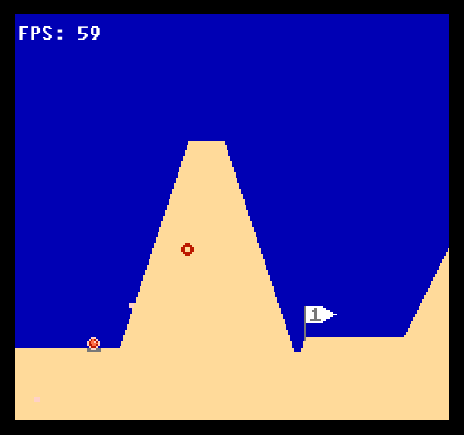
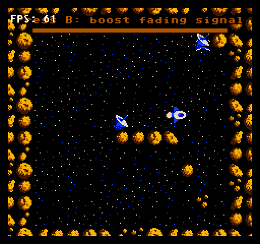

<p align="center">
  <a href="./assets/play-nes-console-logo.svg">
    
  </a>
</p>

<h1 align="center">play-nes</h1>

play-nes is a desktop NES emulator written in TypeScript and running on Node.js. It uses [JSNES](https://github.com/bfirsh/jsnes) for emulation and [sfml.js](https://sfml.js.org/) for native windows, graphics and audio. Local ROM files and keyboard input for two players are supported.

## Screenshots

| Contra | Concentration Room | NESert Golfing | Interglactic Transmissing! |
| :---: | :---: | :---: | :---: |
| [](./assets/screenshots/contra.png) | [](./assets/screenshots/concentration-room.png) | [](./assets/screenshots/nesert-golfing.png) | [](./assets/screenshots/interglactic-transmissing.png) |

Captured from the player on macOS.

## Installation

Install from [npm](https://www.npmjs.com/package/play-nes) and launch a bundled game:

```bash
$ npm install -g play-nes
$ nes contra
```

Node.js 22 is recommended. Installation also requires Python and a C++20 compiler because sfml.js builds a native addon.

<details>
<summary>Platform setup</summary>

| Platform | Toolchain |
| :--- | :--- |
| macOS 13+, Intel or Apple Silicon | Xcode Command Line Tools |
| Linux x64 | GCC or Clang, make, X11, OpenGL and audio development libraries |
| Windows x64 / ia32 | Visual Studio 2022 C++ Build Tools |

The [sfml.js installation guide](https://sfml.js.org/guide/getting-started) has the platform-specific commands. The supported Node.js range is `^18.19.0 || >=20.5.0`.

A graphical desktop and an audio output device are required to run the player.

</details>

## Usage

Pass a ROM path to `nes`:

```sh
$ nes "/path/to/your game.nes"
```

The following aliases load the four bundled ROMs:

```sh
$ nes contra        # Contra
$ nes croom         # Concentration Room
$ nes dgolf         # NESert Golfing
$ nes transmissing  # Interglactic Transmissing!
```

## Controls

| NES button | Player 1 | Player 2 |
| :--- | :---: | :---: |
| A | <kbd>J</kbd> | <kbd>Numpad 5</kbd> |
| B | <kbd>K</kbd> | <kbd>Numpad 6</kbd> |
| Select | <kbd>Right Shift</kbd> | <kbd>Numpad 8</kbd> |
| Start | <kbd>Enter</kbd> | <kbd>Numpad 9</kbd> |
| Up | <kbd>W</kbd> | <kbd>↑</kbd> |
| Down | <kbd>S</kbd> | <kbd>↓</kbd> |
| Left | <kbd>A</kbd> | <kbd>←</kbd> |
| Right | <kbd>D</kbd> | <kbd>→</kbd> |

Press <kbd>Esc</kbd> or close the window to exit. The player releases held buttons when the window loses focus.

Edit [keybindings.conf](./keybindings.conf) to change the controls. Values must use [sfml.js key names](https://sfml.js.org/reference/enums/KeyboardKey.html). Restart the player to apply changes.

## Options

```bash
$ nes contra --scale 3
$ nes croom -f 60 -s 2
$ nes --help
```

| Option | Default | Description |
| :--- | :---: | :--- |
| `-s`, `--scale` | `2` | Scale the 256 × 240 frame; the default window is 512 × 480. |
| `-f`, `--frameRate` | `60` | Emulation and display rate, from 10 to 240 fps. |
| `-h`, `--help` | — | Show usage and exit. |

Use `-f 60` for normal speed. This option controls emulation speed as well as the display rate, so increasing it also accelerates the game. Scale must be positive and produce whole-pixel window dimensions.

## Development

To run from source:

```bash
$ git clone https://github.com/XadillaX/play-nes.git
$ cd play-nes
$ npm install
$ node bin/nes contra
```

`$ npm install` installs dependencies and compiles [`src/`](./src) into `dist/`. Run `$ npm run build` after changing TypeScript. Use `$ npm link` to register the local checkout as the `nes` command.

```bash
$ npm run check        # Check TypeScript types
$ npm run lint         # Run ESLint
$ npm test             # Build and run tests
$ npm run test:native  # Open each bundled ROM and check video, input and audio
```

We use audio consumption to pace emulation. JSNES runs in an audio Worker and advances when SFML requests more PCM samples. The main thread draws the latest complete frame, so rendering does not block audio generation.

The threads exchange video frames and controller state through shared memory. The main thread reuses its texture and sprite to limit allocation, then yields between frames so Node.js can process I/O. The implementation is in [`emulator.ts`](./src/emulator.ts), [`shared-state.ts`](./src/shared-state.ts) and [`game.ts`](./src/game.ts).

## Contributing

For bug reports, [open an issue](https://github.com/XadillaX/play-nes/issues) with the ROM name, operating system, Node.js version, reproduction steps and any error output. Pull requests are welcome.

[MIT licensed](./LICENSE).
